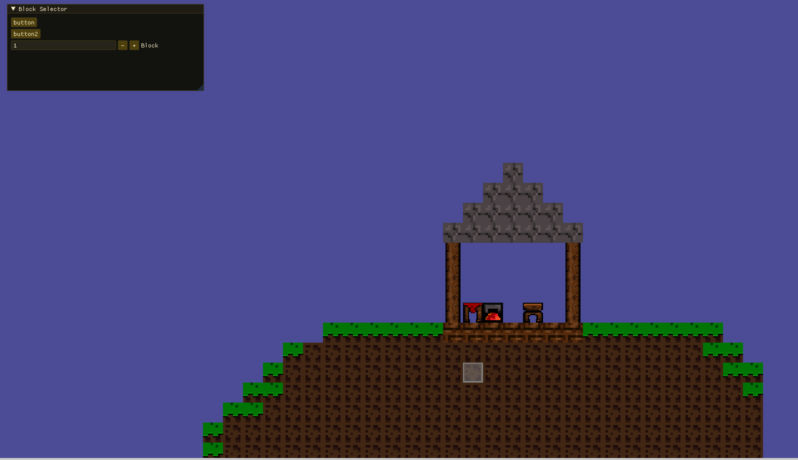

# terraria-clone

Toy project to learn low level gamedev fundamentals with C++ and raylib. 

## Current state:

Recently added a simple Block selector via an input field in ImGui, to test the block placement and mouse to 2D coords funtion.

Docs I used: 
https://pthom.github.io/imgui_explorer/?lib=imgui

Some more assets: 
https://blacis.itch.io/pixel-monsters-mega-pack
https://blacis.itch.io/pixel-weapons-mega-pack