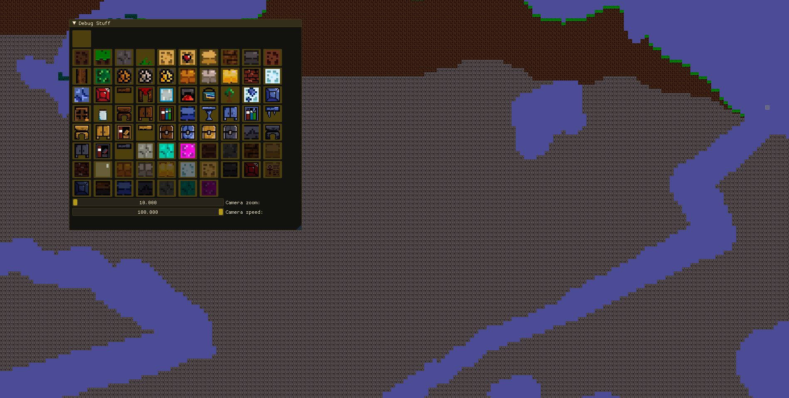
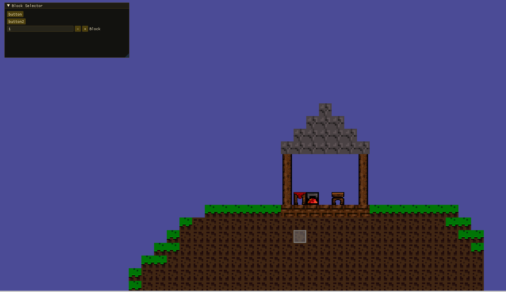

# terraria-clone

Toy project to learn low level gamedev fundamentals with C++ and raylib. 

## Current state:

Currently working on worldgen and predefined structures.

### Planned enhancements / ideas after base implementation

- [ ] More Biomes
- [ ] Better World Generation
- [ ] Character Creation
- [ ] Implement a basic fragment shader for underground lighting

Docs I used: 
https://pthom.github.io/imgui_explorer/?lib=imgui

Some more assets: 
https://blacis.itch.io/pixel-monsters-mega-pack
https://blacis.itch.io/pixel-weapons-mega-pack

